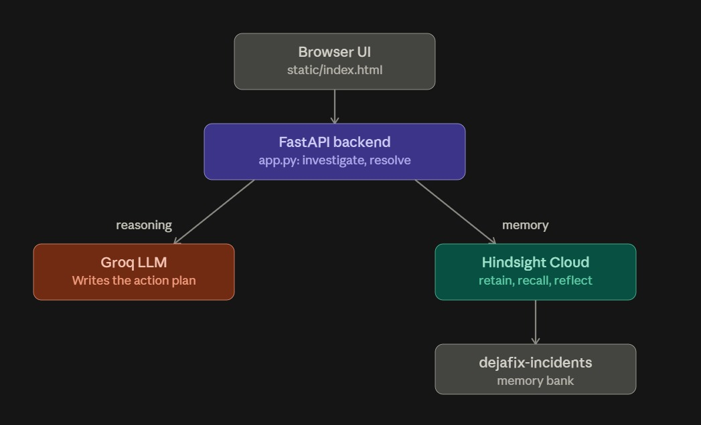
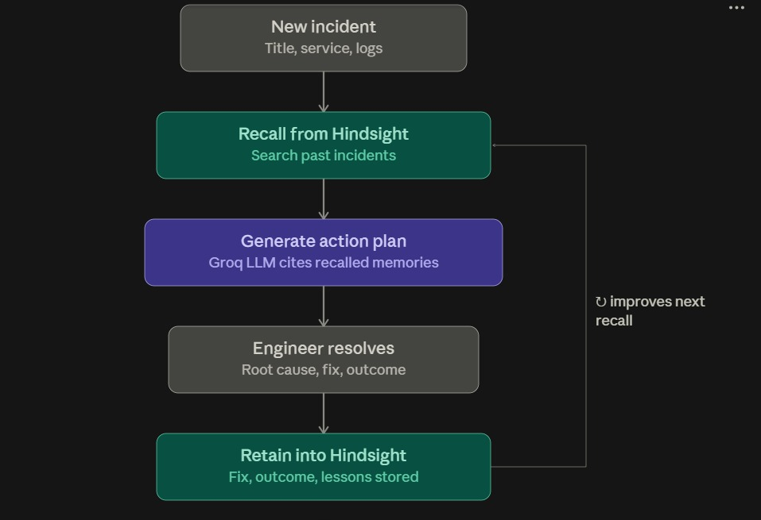
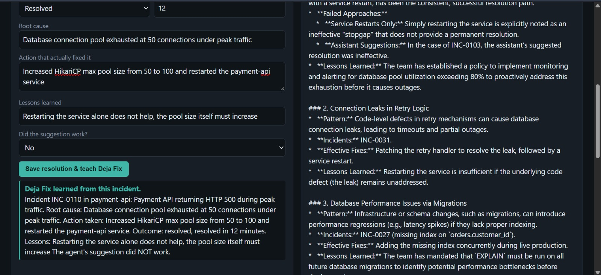
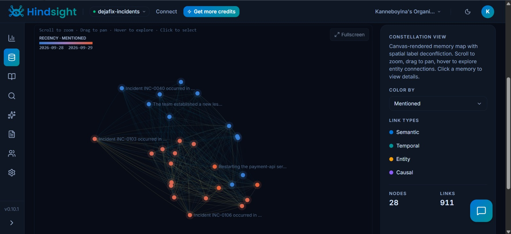
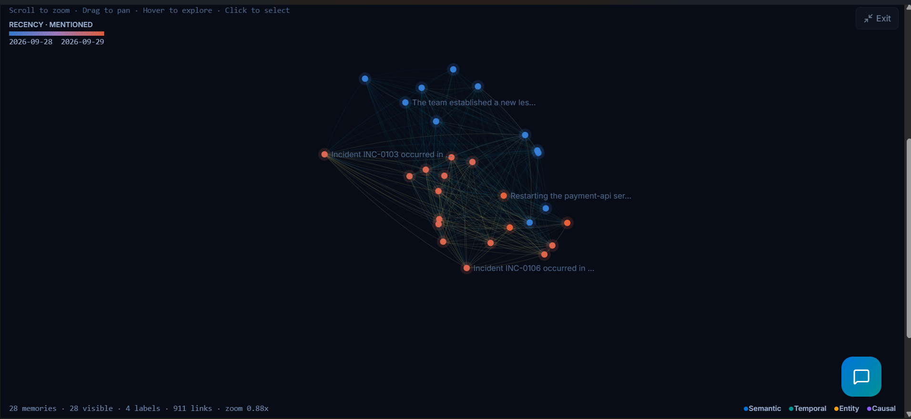
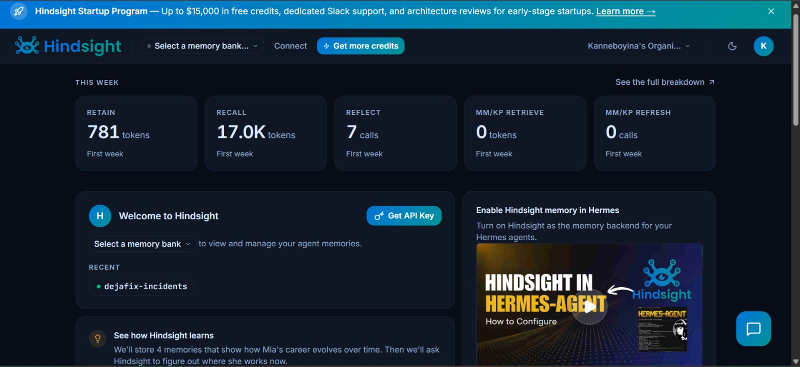

# Deja Fix — incident response that remembers

An on-call agent that recalls past incidents, root causes, and which fixes worked or failed, then learns from each new outcome using [Hindsight](https://hindsight.vectorize.io/) memory.

Paste an alert and Deja Fix tells you what happened last time: the root cause, the fix that worked, and the fixes that did not. Resolve the incident and it remembers that too, so the next on-call engineer starts with more context than the last one.

## Proof this uses real Hindsight memory, not a mock

- Live Hindsight Cloud bank: `dejafix-incidents`, viewable in the [Hindsight dashboard](https://ui.hindsight.vectorize.io)
- Real client, real API calls. There is no local database pretending to be memory:

```python
from hindsight_client import Hindsight
hs = Hindsight(base_url=os.getenv("HINDSIGHT_BASE_URL"), api_key=os.getenv("HINDSIGHT_API_KEY"))

# recall: search past incidents by meaning
res = hs.recall(bank_id=BANK, query=query)

# retain: store what actually fixed it (and what did not)
hs.retain(bank_id=BANK, content=content, context="production incident", timestamp=...)

# reflect: synthesize patterns across every incident retained so far
hs.reflect(bank_id=BANK, query=q)
```

- **Before/after, same incident:** with memory OFF the agent gives generic guesses. With memory ON it recalls earlier payment-api pool-exhaustion incidents and cites them (screenshots below).
- **Independent proof it's real:** the Hindsight dashboard's own Constellation graph connects retained incidents through semantic, temporal, entity, and causal links. The bank currently holds 43 memories connected by 1,068 links (screenshots below), and none of those links were defined by us.

## What changed in this version

- **Larger, realistic dataset:** `seed_incidents.py` loads 24 synthetic incidents across 7 services (payment-api, auth-service, order-service, inventory-service, search-service, reporting-api, gateway). Each has a real-looking log line, a root cause, **fixes that did not work**, the fix that did, resolution time, and a lesson. Root causes recur (connection-pool exhaustion, Redis eviction, bad config deploys, keepalive mismatches), so memory has real patterns to learn from.
- **Learning-curve demo:** `learning_curve.py` runs the same kind of incident with memory OFF, then ON, then resolves a new incident and runs a third, similar one so you can see the agent cite what it just learned.
- **Input validation:** the resolve form now requires a root cause and an action (at least 5 characters each). The API returns a 422 and the UI shows a clear message, so we no longer retain near-empty memories. This was a known limitation in our previous version.
- **Service list** in the UI now matches the dataset, and new incident IDs start at INC-0201 so they never collide with seeded ones.

## Architecture

The browser talks to a FastAPI backend, which splits into two calls: Groq for LLM reasoning, and Hindsight Cloud for memory (retain, recall, reflect) against a dedicated `dejafix-incidents` bank.



## How Hindsight memory is used

- **retain:** on resolution, the incident, root cause, fix, failed attempts, outcome, time and lessons are stored (`POST /api/resolve`, `seed_incidents.py`).
- **recall:** every new alert is turned into a query and matched against past incidents (`POST /api/investigate`, memory ON vs OFF toggle).
- **reflect:** synthesizes recurring failure patterns across the bank (`GET /api/reflect`).
- **Health:** `GET /api/health/hindsight`. If Hindsight is down the UI says so; there is no fake local memory.



## Demo: before and after memory

**Memory OFF: generic troubleshooting, no history**


**Memory ON: related past incidents recalled from Hindsight, ranked**


**Input validation: an empty root cause is rejected instead of silently saved**


**Resolving the incident teaches Deja Fix**



**Hindsight's own memory graph, built automatically from retained incidents**





**The Hindsight dashboard for this project's bank**



## Built with Band AI

We installed Band desktop, created a room, attached our project files (`app.py`, `README.md`) and assigned a review task to the Express Author agent.


The agent run was blocked: Band's Express agents run on Claude Code and returned "Claude Code is not signed in", because we did not have a paid Claude Code login. We used Band for workspace setup and task assignment only; no agent output from Band is part of this project's code.

## Run

```
python -m venv .venv && source .venv/bin/activate   # Windows: .venv\Scripts\activate
pip install -r requirements.txt
cp .env.example .env        # fill in Hindsight + Groq keys
python seed_incidents.py    # load 24 realistic past incidents (takes a few minutes)
uvicorn app:app --reload    # open http://localhost:8000
python learning_curve.py    # in a second terminal: scripted learning-curve demo
```

## Environment variables

See `.env.example`. You need:

- `HINDSIGHT_BASE_URL`: `https://api.hindsight.vectorize.io`
- `HINDSIGHT_API_KEY`: from the Hindsight Cloud dashboard
- `HINDSIGHT_BANK_ID`: `dejafix-incidents`
- `GROQ_API_KEY`: from console.groq.com
- `LLM_MODEL` / `LLM_FALLBACK_MODEL`: `openai/gpt-oss-120b` / `qwen/qwen3-32b`

## Demo script

1. Memory OFF, investigate "Payment API 500": generic advice.
2. Memory ON, same incident: related past incidents are recalled, including what was tried before.
3. Resolve it (for example, root cause: pool exhaustion, fix: raise pool size) and save. Try saving with an empty root cause to see the validation.
4. Investigate a similar incident on another service: it now cites the one you just saved.
5. Click Reflect for cross-incident patterns.
6. Optional: run `python learning_curve.py` to see steps 1 to 4 scripted.

## Known limitations

- The incident data is synthetic. It is written to look like real production incidents, but it is not from a real company.
- Our Hindsight bank also contains incidents saved during earlier testing, so recalled results can include those alongside the seeded ones.
- Recall quality depends on how similar the new alert's wording is to retained incidents; we have not tuned ranking.
- There is no authentication, and one shared bank is used for all users.
- Band agents could not run tasks without a paid Claude Code sign-in (see the Band section).

## Tech stack

Python, FastAPI, `hindsight-client`, Groq API, `httpx`, `python-dotenv`, single-page HTML/CSS/JS frontend.

## Links

- Hindsight GitHub: https://github.com/vectorize-io/hindsight
- Hindsight docs: https://hindsight.vectorize.io/
- Vectorize agent memory: https://vectorize.io/what-is-agent-memory
